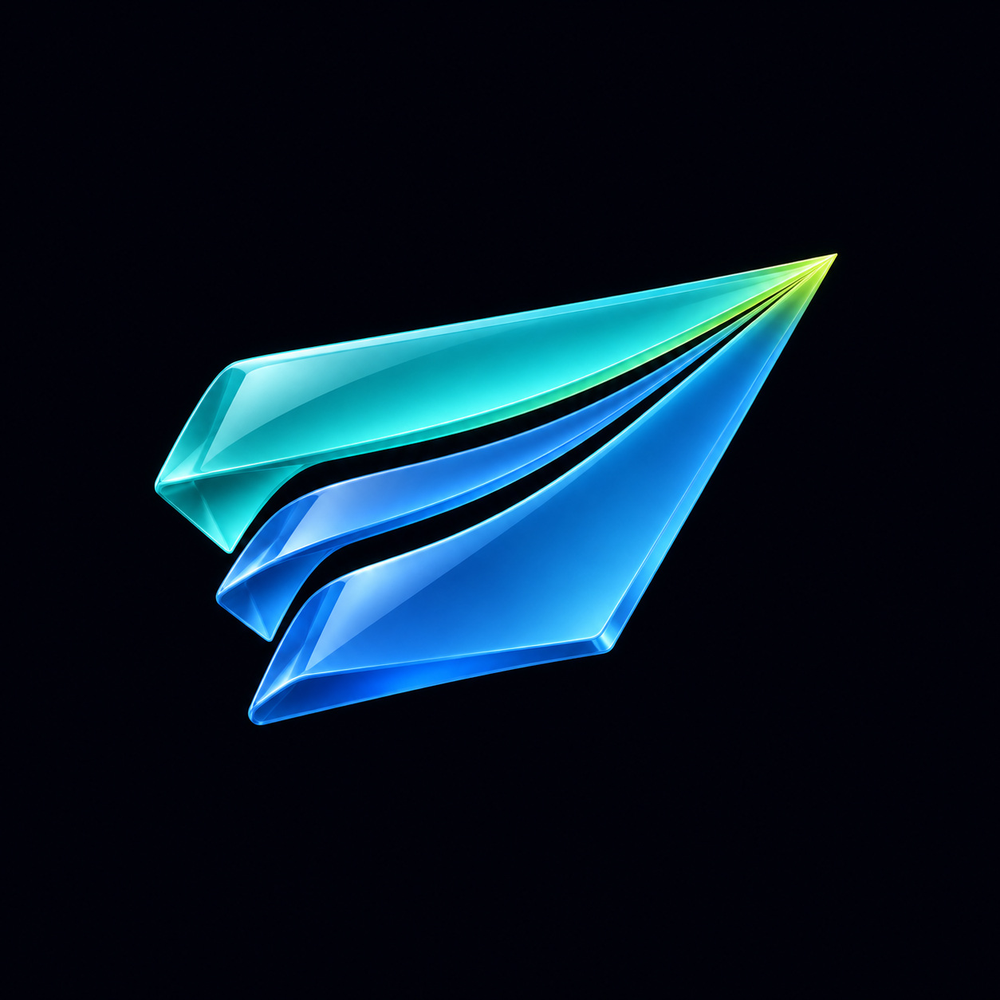

# Mux

Mux brings conversations from several messaging networks into one app. The name is
short for multiplexer: several streams combined into one.

## Selected logo

Rami selected this three-fold glass paper plane on 2026-11-06. Three separate paths
converge at one nose, with broad folded wings, open channels, and short staggered
trailing ends. This is the approved artwork, not the chat-bubble explorations.

The source is the unmodified 1254 x 1254 PNG produced with the built-in imagegen
tool, copied into `apps/multiplexer/assets/mux-icon.png`. `app.json` selects it for
the installed app icon and web manifest. The dark background is part of the icon;
platforms apply their own outer icon mask.

## Color and material

| Color | Value | Role |
|---|---|---|
| Turquoise | `#57DED4` | Upper glass wing |
| Blue | `#519AFF` | Lower and internal folds |
| Lime | `#D4F46A` | Small convergence highlight |
| Deep space | `#0C1118` | Icon background |

These values guided the image generation; the rendered glass includes shading and
refraction. The app stays neutral and uses its existing appearance settings. The
logo's colors do not override a chosen accent or message theme.

## App identity

Use **Mux** in visible copy, device display names, push display names, and media
vendor metadata. Keep `com.ramimaalouf.multiplexer`, the existing Keychain services,
App Group, push topics, storage paths, source folder, component names, package names,
and test-room names stable. Renaming them would change installation, data, or test
identity rather than the visible brand. Historical evidence keeps its original names.

## Generation prompt

The final artwork used the converging-ribbon paper plane and the earlier hybrid
paper plane as references. The brief was to blend their three readable folded
paths and two tapering channels with a coherent broad-winged plane and central
origami valley. The outer wings stay substantial, with a narrow middle ribbon;
all three join at one nose aimed upper-right. Optical glass carries turquoise,
blue, and a small lime highlight on a quiet dark background. No chat-bubble form,
lettering, enclosing tile, or decorative scenery.
